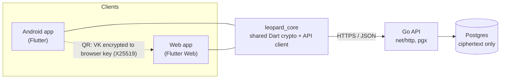

# Leopard

A personal, single-user, zero-knowledge password manager.

- **Phone app (Android, Flutter)** — the root of trust. Holds the vault key and
  a device signing key, stores and syncs encrypted items.
- **Web app (Flutter Web)** — stores nothing. You log in by scanning a QR code
  with the phone (like Steam); the phone sends the vault key to the browser
  end-to-end encrypted, and the browser forgets it after 5 minutes idle.
- **API (Go)** — stores ciphertext, relays the QR handshake, manages sessions.
  It never sees the vault key, the master password or any plaintext.

## Features

- **Zero-knowledge vault** for logins, payment cards (no CVV), Wi-Fi networks,
  API keys, SSH keys and secure notes. Every field is encrypted on the client.
- **Phone as the key:** the Android app holds the vault key behind the device
  screen lock; the browser gets it only for a session, through a QR handshake.
- **Emergency access** with master password + TOTP when the phone is not at hand.
- **Recovery key** on paper to move the vault to a new phone.
- **Password and passphrase generator** (EFF wordlist) with entropy estimate,
  and a password health report (weak, reused, old).
- **Sessions and audit log:** see and revoke web sessions from the phone.
- **Hardened web client:** strict CSP, no persistent storage, auto-lock after
  5 minutes idle, clipboard cleared after 30 seconds.

## Architecture



| Layer | Stack |
|---|---|
| API | Go 1.24, standard `net/http`, `pgx` v5, embedded SQL migrations, distroless image |
| Client core | Dart: AES-256-GCM, HKDF-SHA256, Argon2id, X25519, Ed25519 (`cryptography`) |
| Apps | Flutter, Material 3, BLoC/Cubit, Clean Architecture (domain / data / presentation) |
| Design | `packages/leopard_ui`: theme tokens, custom SVG icon set, bundled fonts |
| CI | GitHub Actions: Go tests with Postgres, Dart/Flutter analyze + tests, APK and web builds |

## Layout

```
backend/                     Go module (API server)
  cmd/leopard-api/           entrypoint
  internal/crypto/           reference implementation of docs/crypto-spec.md
  internal/httpapi/          routes, middleware, handlers
  internal/store/            Store interface, Postgres (pgx) and in-memory implementations
  internal/migrations/       embedded SQL migrations
  internal/auth/             bearer tokens, server-key secret box
  internal/totp/             RFC 6238
  internal/ratelimit/        in-memory token buckets
  internal/config/           environment configuration
  Dockerfile                 distroless, static, non-root
packages/leopard_core/       shared pure-Dart client core: crypto, models, API client, generator, audit
packages/leopard_ui/         shared design: Material 3 theme, icons, fonts
apps/mobile/                 Android app (Flutter)
apps/web/                    web app (Flutter Web)
docs/
  crypto-spec.md             the protocol, byte for byte
  test-vectors.json          known-answer vectors every implementation must reproduce
  api.md                     every endpoint with examples
  deploy.md                  Render or Cloud Run, Neon, Netlify
```

## How it works (short version)

- The phone generates a random 32-byte **vault key (VK)**. Items are encrypted
  with AES-256-GCM under a key derived from VK; the item id and version are
  authenticated so ciphertexts cannot be swapped or silently rolled forward.
- VK is stored on the server only in wrapped form: once under a key derived
  from the **master password** (Argon2id, 64 MiB) and once under a key derived
  from a random **recovery key**.
- **QR login:** the browser shows an ephemeral X25519 public key as a QR code;
  the phone encrypts VK to it, signs the approval with its Ed25519 device key,
  and the server hands the result to the browser exactly once. Both screens
  show the same 6-digit code.
- **Emergency login** without the phone: master password + TOTP.
- **Lost phone:** the recovery key registers a new phone and revokes the old one
  ("Restore with recovery key" on the first screen of the Android app). The
  vault key is not rotated yet (see Roadmap).

Details and threat model: [`docs/crypto-spec.md`](docs/crypto-spec.md).

## Run the backend locally

Requires Go 1.24+.

Quickest, no database (data is lost on exit):

```sh
cd backend
export LEOPARD_DEV_MEMSTORE=1
export LEOPARD_SERVER_KEY=$(openssl rand -base64 32)
export LEOPARD_WEB_ORIGIN=http://localhost:5173
go run ./cmd/leopard-api
curl -s localhost:8080/healthz      # {"status":"ok"}
```

With Postgres (migrations are applied automatically at start):

```sh
createdb leopard
export DATABASE_URL='postgres://localhost/leopard?sslmode=disable'
export LEOPARD_SERVER_KEY=$(openssl rand -base64 32)   # keep it: it must stay the same for this database
go run ./cmd/leopard-api
```

All settings are listed in [`backend/.env.example`](backend/.env.example):

| Variable | Meaning |
|---|---|
| `DATABASE_URL` | Postgres URL (`sslmode=require` for Neon) |
| `PORT` | Listen port, default `8080` |
| `LEOPARD_WEB_ORIGIN` | Allowed browser origin(s) for CORS, comma separated |
| `LEOPARD_SERVER_KEY` | 32 random bytes, base64; encrypts the TOTP secret at rest |
| `LEOPARD_TRUST_PROXY` | Number of trusted proxy hops in `X-Forwarded-For` (`1` Cloud Run, `2` Render) |
| `LEOPARD_SETUP_TOKEN` | Optional: required header value for `POST /v1/setup` |
| `LEOPARD_DEV_MEMSTORE` | `1` = in-memory store, development only |

## Tests

```sh
cd backend
go vet ./...
go test ./...
```

The Postgres integration tests are skipped unless you point them at a
**disposable** database (they drop and recreate its schemas):

```sh
LEOPARD_TEST_DATABASE_URL='postgres://localhost/leopard_test?sslmode=disable' go test ./...
```

`go test ./internal/crypto` fails if the implementation no longer reproduces
`docs/test-vectors.json`.

The Dart client core has its own suite, which checks the same vectors:

```sh
cd packages/leopard_core
dart pub get
dart test
```

## Deploy

See [`docs/deploy.md`](docs/deploy.md): the API runs as a single Docker
service (Render free tier or Cloud Run), the database on Neon Postgres, and the
web app as static files on Netlify behind strict security headers.

## Roadmap

- Encrypted offline cache on the phone, so the vault opens without the server.
- Encrypted export file for offline backups.
- Vault key rotation after a recovery; changing the master password.
- One-time codes generated from TOTP secrets stored in login items.

## How it was built

I designed and directed this project; the implementation was done with
AI-assisted development (Claude), working from specifications I wrote and
reviewed.

**My part**
- Product and security requirements: zero-knowledge storage, the phone as the
  only key, QR sign-in for the web, emergency access with master password + TOTP,
  a paper recovery key.
- Key decisions: Go for the API, Flutter for Android and web with a shared Dart
  core, device screen lock instead of biometrics, free-tier hosting
  (Render, Neon, Netlify), the visual design and brand colour.
- Deployment and operations: provisioning the database and API, signing and
  installing the Android app, configuring CORS and the web CSP.
- Testing on a real device and browser, and deciding what to fix.

**Process**
- A written crypto specification with test vectors came first; the Go server and
  the Dart client must both reproduce the same vectors.
- Every change goes through CI: Go tests against Postgres, Dart and Flutter
  analysis and tests, Android and web release builds with CSP checks.
- Security-sensitive changes got an independent review pass before merging;
  its findings were fixed and covered by tests.

## License

Copyright 2026 Oxunov Azizbek. Licensed under the [Apache License 2.0](LICENSE).
